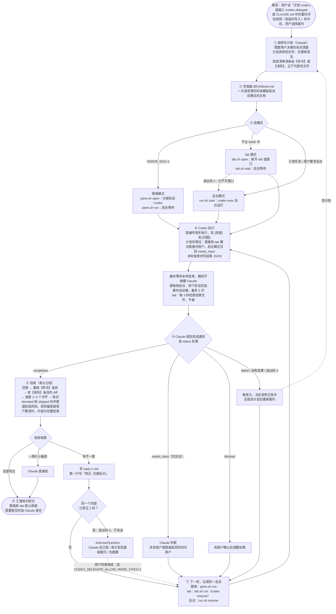

# claude-skill

让 Claude Code 和 OpenAI Codex 协作的 skill：Claude 负责调研、计划和验收，Codex 负责执行或审查，以节省 Claude 的 token。

## 包含的 skill

- `codex-delegate`：Claude 负责调研、制定计划和验收，Codex 负责执行。Codex 默认可见：在 herdr 中分屏，在其它终端中新开 tab（开不了就用 macOS 自带终端开新窗口）；只读任务在后台运行。
- `codex-review`：用户主动触发的 Codex 只读审查：代码改动（未提交改动 / 相对某分支 / 某个提交）或计划文件（对照代码核实可行性），可指定重点；Claude 核实每条意见后由用户决定修哪些。

## 依赖

- [Codex CLI](https://github.com/openai/codex)，并已登录：`npm i -g @openai/codex && codex login`。`codex-review` 需要支持 `codex exec review` 的版本
- `jq`、`git`
- 可选：herdr，用于分屏显示 Codex。没有的话，tab 模式支持 tmux、WezTerm、kitty、Ghostty、iTerm2，都不可用时用 macOS 自带终端开新窗口；没有图形界面（如 SSH）时改为后台运行

## 安装

```bash
git clone https://github.com/ChaterV/claude-skill.git
cd claude-skill
./install.sh --check   # 先看状态，不做修改
./install.sh           # 把 claude/skills/ 下的每个 skill 软链接到 ~/.claude/skills/
```

- 在 `~/.claude/skills/` 下建 `codex-delegate`、`codex-review` 两个软链接。已有同名 skill 且内容不同时，先备份到 `~/.claude/backups/claude-skill-<时间>/`，再换成软链接。
- 在 `~/.claude/CLAUDE.md` 末尾写入一段「执行前评估是否委托 Codex」的规则（见下文），前后带标记，文件不存在时新建。改之前先备份，文件里的其它内容不动。
- 不改 `settings.json` 等其它配置。设置了 `CLAUDE_CONFIG_DIR` 时装到它下面。
- 脚本最后会检查依赖，缺什么会提示。

更新：在仓库目录 `git pull`，skill 是软链接，自动生效。委托规则是复制进 `CLAUDE.md` 的，规则有变化（`./install.sh --check` 提示「过期」）或仓库新增了 skill 时，再运行一次 `./install.sh`。

卸载：`./install.sh --uninstall`，移除本仓库建立的软链接和 `CLAUDE.md` 中的那段规则（改之前先备份；文件里只剩这段规则时整个删除）。

## 使用

- 委托执行：对 Claude 说「交给 codex」「让 codex 实现/修」，或输入 `/codex-delegate`。Claude 先调研、和你确认计划，再交给 Codex 执行，完成后对照计划验收。
- 审查：说「让 codex 审查一下改动」「让 codex 审一下这个计划」，或输入 `/codex-review`，可以附上审查重点。Claude 核实每条意见后，由你决定采纳哪些。

## codex-delegate 工作流程



| | 窗格（herdr） | tab | 后台 |
|---|---|---|---|
| 什么时候用 | `HERDR_ENV=1` | 不在 herdr 中 | 只读任务 / 用户要求后台 / tab 打不开 |
| 用户能看到 Codex | 是，分屏 | 是，新 tab 或新窗口 | 否（可以用 `progress.sh --watch` 看） |
| 遇到要决策的问题 | 用户在窗格里回答 | 用户在 tab 里回答 | 交回 Claude（`needs_input`） |
| Codex 停下却没交结果 | 脚本自动催，最多 5 次 | 不催，由用户在 tab 里让它继续 | 脚本自动催，最多 5 次 |
| 怎么判断一轮结束 | herdr 报告的 agent 状态 | 每 3 秒检查结果文件 | `codex exec` 进程退出 |
| 后续轮次 | 在同一个进程里接着发 | 结束进程后 `codex resume <SID>` | `codex exec resume <thread_id>` |

## 委托评估规则

skill 只有在用户说「交给 codex」等触发词时才会加载，不会主动提出委托。所以安装时会往 `~/.claude/CLAUDE.md` 写入一段规则：计划定下来、开始改代码之前，如果改动量大（约 10 个文件或 300 行以上、每处都要看上下文的重复修改、要多轮测试修复），Claude 会先问你要自己执行还是委托 Codex；小改动、能用一条脚本完成的批量替换、高风险逻辑不提示。

- 规则原文：`claude/skills/codex-delegate/references/claude-md-rule.md`，要调整就改这个文件，再运行 `./install.sh`
- 在 `CLAUDE.md` 里位于 `<!-- BEGIN claude-skill codex-delegate … -->` 和 `<!-- END claude-skill codex-delegate -->` 之间，手改这一段会在下次安装时被覆盖
- 不想要这条规则：删掉这两行标记和中间的内容即可（之后不要再运行 `./install.sh`，否则会重新写入）

## 修改 skill

skill 目录是指向仓库的软链接，在 `~/.claude/skills/...` 里改，或者让 Claude 修改 skill，都会直接改到仓库里的文件。

- 有些编辑器保存时会把软链接替换成普通文件，之后的改动就不会进入仓库。`./install.sh --check` 出现「已分叉」就是这种情况：用 `./install.sh --adopt` 以本地版本为准收回仓库，或者直接 `./install.sh` 以仓库版本为准（本地版本会备份）。
- skill 里不写死路径：skill 用 `${CLAUDE_SKILL_DIR}`，脚本按自身位置定位。
- 修改 `codex-delegate` 的脚本前先读 `claude/skills/codex-delegate/references/maintenance.md`。
