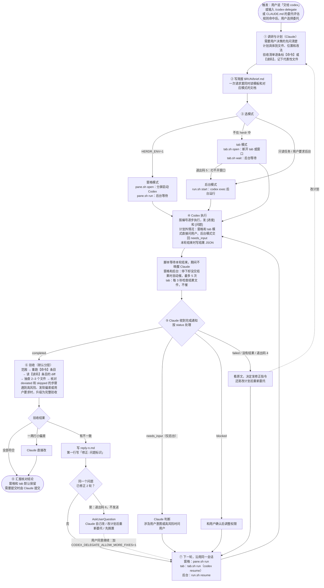

# claude-skill

个人 Claude Code 配置与 skill。用软链接挂到 `~/.claude/`，多台机器通过 git 同步。

## 内容

| 仓库路径 | 链接到 | 说明 |
|---|---|---|
| `claude/CLAUDE.md` | `~/.claude/CLAUDE.md` | 全局指令 |
| `claude/settings.json` | `~/.claude/settings.json` | 模型、思考强度、插件、hooks |
| `claude/skills/<name>/` | `~/.claude/skills/<name>` | 自定义 skill；`claude/skills/` 下每个目录都会被链接 |

skill 列表：

- `codex-delegate`：Claude 负责调研、制定计划和验收，Codex 负责执行。Codex 默认可见：在 herdr 中分屏，在其它终端中新开 tab（开不了就用 macOS 自带终端开新窗口）；只读任务在后台运行。
- `codex-review`：用户主动触发的 Codex 只读审查：代码改动（未提交改动 / 相对某分支 / 某个提交）或计划文件（对照代码核实可行性），可指定重点；Claude 核实每条意见后由用户决定修哪些。

## codex-delegate 工作流程



| | 窗格（herdr） | tab | 后台 |
|---|---|---|---|
| 什么时候用 | `HERDR_ENV=1` | 不在 herdr 中 | 只读任务 / 用户要求后台 / tab 打不开 |
| 用户能看到 Codex | 是，分屏 | 是，新 tab 或新窗口 | 否（可以用 `progress.sh --watch` 看） |
| 遇到要决策的问题 | 用户在窗格里回答 | 用户在 tab 里回答 | 交回 Claude（`needs_input`） |
| Codex 停下却没交结果 | 脚本自动催，最多 5 次 | 不催，由用户在 tab 里让它继续 | 脚本自动催，最多 5 次 |
| 怎么判断一轮结束 | herdr 报告的 agent 状态 | 每 3 秒检查结果文件 | `codex exec` 进程退出 |
| 后续轮次 | 在同一个进程里接着发 | 结束进程后 `codex resume <SID>` | `codex exec resume <thread_id>` |

## 新机器安装

```bash
git clone <仓库地址> ~/WebstormProjects/claude-skill
cd ~/WebstormProjects/claude-skill
./install.sh --check   # 先看状态
./install.sh           # 建立软链接；本地已有的不同文件会先备份到 ~/.claude/backups/
```

## 日常同步

由于是软链接，在任意位置修改都会直接改到仓库里的文件，无论是编辑 `~/.claude/...` 还是让 Claude 修改 skill。

```bash
git add -A && git commit -m "..." && git push   # 改动的机器
git pull                                        # 其它机器；软链接自动生效
```

新增 skill 时，把目录放进 `claude/skills/`，然后运行一次 `./install.sh`。

## 软链接被替换时

Claude Code（例如 `/config`、`/model`、安装插件）和 herdr（安装集成）可能会用"写临时文件再替换"的方式改写 `settings.json`。这样会把软链接变成普通文件，之后的改动就不会进入仓库。

- `./install.sh --check`：出现「已分叉」就说明发生了这种情况
- `./install.sh --adopt`：以本地版本为准，收回仓库并重建链接，用 `git diff` 确认改动
- `./install.sh`：以仓库版本为准，本地版本会备份到 `~/.claude/backups/`

## 不在仓库里的内容

| 内容 | 原因 / 在新机器上的做法 |
|---|---|
| `~/.claude/hooks/herdr-agent-state.sh` | 由 herdr 管理、会被自动覆盖。新机器上通过 herdr 的集成安装重新生成 |
| `~/.agents/skills/*`（accessibility、performance 等） | 由 `npx skills` 安装，有自己的 `~/.agents/.skill-lock.json` |
| `~/.claude/skills/synced/` | claude.ai 账号自动同步下来的 skill |
| `~/.claude/projects/`（会话记录与 memory）、`history.jsonl`、`sessions/`、`cache/` | 运行数据。memory 的路径和本机的项目路径绑定，无法跨机器直接复用 |
| `~/.claude.json` | 包含账号状态和 MCP 配置，不适合整份同步 |

## 与机器相关的注意事项

- 配置和 skill 里不写死路径：`settings.json` 的命令用 `~/.claude/...`，skill 用 `${CLAUDE_SKILL_DIR}`，脚本按自身位置定位。
- herdr 的 SessionStart hook 只在 `~/.claude/hooks/herdr-agent-state.sh` 存在时才运行，没装 herdr 的机器会直接跳过。
- 重新运行 `herdr integration install claude` 时，herdr 可能把 hook 命令改回绝对路径，还可能把 `settings.json` 的软链接替换成普通文件。之后用 `./install.sh --check` 检查；如果出现「已分叉」，用 `--adopt` 收回，再把路径改回 `~`。
- 插件（`claude-seo`）的市场信息在 `settings.json` 里，新机器首次启动后，可能需要用 `/plugin` 安装或启用。
- `codex-delegate` 依赖 `codex` CLI（已登录）、`jq`；分屏需要 `herdr`，没有的话改为新开 tab 或窗口。
- `codex-review` 依赖 `codex` CLI（已登录，需支持 `codex exec review`）、`jq`。
